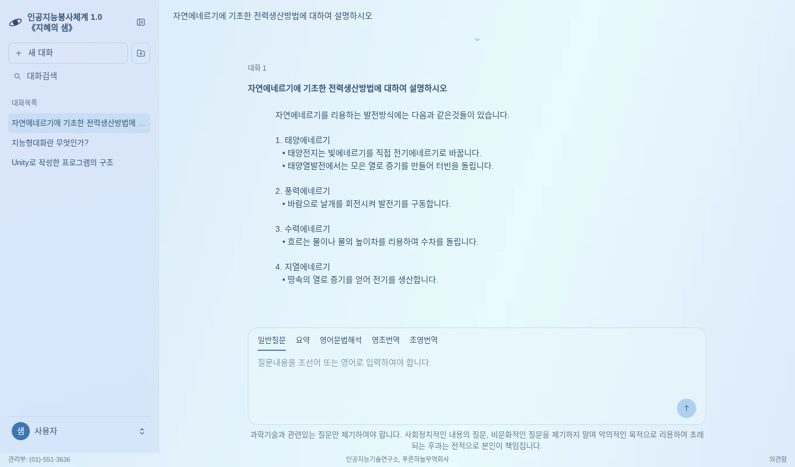
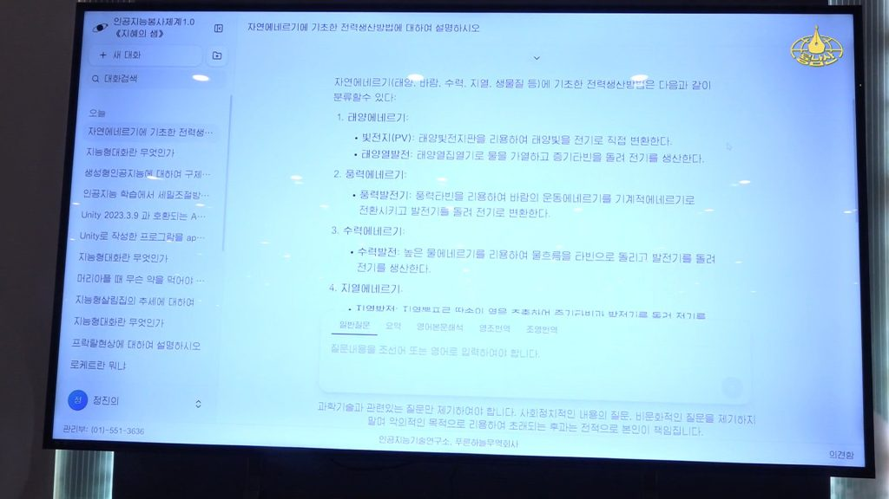

# 지혜의 샘 · 智慧之泉 · Fountain of Wisdom

[조선말](#ko) · [简体中文](#zh) · [English](#en)

조선의 인공지능봉사체계 《지혜의 샘》을 비공식적으로 재현한 대화 프로그램입니다.  
朝鲜人工智能服务系统《智慧之泉》的非官方复刻。  
An unofficial recreation of the DPRK’s *Fountain of Wisdom* AI chat system.

**재현판 · 复刻版 · Recreation**

**룡남산텔레비죤 방영 화면 · 龙南山电视台演示画面 · Original TV demonstration**

2026-11-17 · 룡남산텔레비죤 / 龙南山电视台 / Ryongnamsan Television. [출처 · 图片来源 · Source: 38 North, Fig. 2](https://www.38north.org/2026/11/north-korea-shows-off-an-ai-chatbot/)

## 조선말

### 실행 방법

1. Python 3.9 또는 그 이후 판을 설치하고 이 디렉토리에서 `python server.py`를 실행하십시오. Linux에서는 `python3 server.py`도 쓸 수 있습니다. Python용 추가 꾸레미는 필요하지 않습니다.
2. 브라우저에서 [대화 화면](http://127.0.0.1:8765)을 열고 왼쪽 아래의 **사용자 → 설정**을 누르십시오.
3. OpenAI 호환 API 주소와 모형 ID를 입력하십시오. 인증이 필요한 경우에는 API Key도 입력하십시오. 본지에서 llama-server를 쓰는 경우 주소의 실례는 `http://127.0.0.1:8080/v1`입니다. 모형 ID는 해당 봉사기의 `/v1/models`에서 확인할 수 있습니다.
4. **＋ 새 대화**를 눌러 시작하십시오. Enter는 보내기, Shift+Enter는 줄바꾸기입니다. 왼쪽에서 이전 대화를 검색할 수 있습니다.

### 언어와 대화 처리

처음에는 조선말로 표시됩니다. **설정 → 언어**에서 조선말, 중국어 간체 또는 영어를 선택할 수 있습니다. 새 답변과 심사 통지는 선택한 언어로 표시되며 이전 대화는 원문 그대로 보관됩니다. 영조번역과 조영번역에서는 해당 번역 방향을 따릅니다. 처음 보이는 세 대화는 실례입니다.

보통 한 차례의 문답에는 같은 모형을 세 번 호출합니다. 먼저 질문과 최근 대화의 문맥을 심사하고, 답변 초안을 작성한 다음, 초안을 심사합니다. 질문이 차단되면 첫 단계에서 범위 안내를 표시합니다. 답변은 심사를 통과한 뒤에 표시됩니다. 통신 오류가 나거나 심사 결과를 판독할 수 없으면 질문을 다시 보낼 수 있습니다.

답변 문체는 `system.txt`, 조선말·중국어·영어 명칭은 `terms.json`, 심사 기준은 `server.py`의 `SCOPE`와 `REVIEW`에서 수정할 수 있습니다. 수정한 뒤 봉사기를 다시 실행하십시오. 질문 심사는 문맥을 고려합니다. 국가의 정식 명칭이나 Raft의 지도자 선거 알고리듬에 관한 질문에는 답하고, 정치 지도자의 우렬을 가리는 질문에는 과학기술 분야의 질문을 제기하도록 안내합니다. 실제 결과는 사용하는 모형에 따라 달라집니다.

`WISDOM_BASE_URL`, `WISDOM_MODEL`, `WISDOM_API_KEY` 환경변수로도 접속을 설정할 수 있습니다. 화면에 입력한 열쇠는 페지의 기억기에만 남습니다. 대화와 열쇠 이외의 설정은 브라우저에 보관됩니다. 봉사기는 본지 접속만 받으며 수식은 동봉한 KaTeX로 표시합니다. 화면은 공개된 자료를 참고하였고 대화 실례와 심사 절차는 이 재현판을 위해 작성하였습니다.

## 简体中文

### 本地运行

1. 安装 Python 3.9 或更高版本，在本目录执行 `python server.py`。Linux 也可用 `python3 server.py`。无需安装 Python 第三方依赖。
2. 打开[聊天界面](http://127.0.0.1:8765)，点击左下角的 **사용자 → 설정**（本地用户 → 设置）。
3. 填写 OpenAI 兼容 API 的地址、模型 ID 和可选密钥。本机 llama-server 的地址示例为 `http://127.0.0.1:8080/v1`，模型 ID 可从该服务的 `/v1/models` 获取。
4. 点击 **＋ 新建对话**。Enter 发送，Shift+Enter 换行，侧栏可以搜索历史会话。

### 语言与回答审查

首次打开默认为朝鲜语。可在 **设置 → 语言** 选择朝鲜语、简体中文或英语。界面、新回复和审查提示跟随所选语言，已有消息保留原文。英译朝和朝译英按各自的目标语言输出。初始三段对话是演示样例。

一次完整问答会调用同一模型三次，依次审查问题及近期上下文、生成草稿、审查草稿。输入被拦截时直接返回范围提示，草稿通过审查后才会显示。审查结果格式异常、接口错误或超时时，输入框会保留问题以便重试。

在 `system.txt` 调整说话风格，在 `terms.json` 编辑三语称谓，在 `server.py` 的 `SCOPE` 和 `REVIEW` 调整审查规则，修改后重启服务。例如，询问国名或 Raft 领导者选举算法时应正常回答，要求比较政治领导人优劣时则提示改提科技问题。实际效果取决于所选模型。

也可用 `WISDOM_BASE_URL`、`WISDOM_MODEL`、`WISDOM_API_KEY` 环境变量配置连接。页面中填写的密钥仅保留在页面内存中，会话和其他设置保存在浏览器本地。服务只监听回环地址。公式由随包附带的 KaTeX 离线渲染。界面参考公开画面，演示对话、提示词和审查流程是本项目的复刻设计。

## English

### Run locally

1. Install Python 3.9 or later and run `python server.py` in this directory. On Linux, you can also use `python3 server.py`. No third-party Python packages are required.
2. Open the [chat interface](http://127.0.0.1:8765) and open **사용자 → 설정** (Local user → Settings) at the bottom of the sidebar.
3. Enter an OpenAI-compatible base URL, model ID, and API key if required. For a local llama-server, a typical base URL is `http://127.0.0.1:8080/v1`. Use the model ID returned by its `/v1/models` endpoint.
4. Select **＋ New chat**. Press Enter to send or Shift+Enter for a new line. Search past chats in the sidebar.

### Languages and answer review

Korean is the default. Under **Settings → Language**, choose Korean, Simplified Chinese, or English. The interface, new replies, and review notices follow this setting. Existing messages retain their original language. The English-to-Korean and Korean-to-English modes follow their selected translation direction. The three initial conversations are examples.

A complete exchange calls the same model three times. It screens the question in context, drafts a reply, and reviews the draft before displaying it. A blocked question receives a scope reminder after the first call. If the endpoint fails, times out, or returns an invalid review decision, the input stays available for retry.

Edit `system.txt` to change the speaking style, `terms.json` to change official terminology in all three languages, or `SCOPE` and `REVIEW` in `server.py` to change the review criteria. Restart the server after editing. Questions about official names or Raft leader election should receive factual answers. Requests to rank political leaders should receive a reminder about the scientific and technical scope. Behavior depends on the model you connect.

You can also configure the connection with `WISDOM_BASE_URL`, `WISDOM_MODEL`, and `WISDOM_API_KEY`. A key entered in the interface stays in page memory. Chats and other settings are saved in local browser storage. The server listens on loopback. Bundled KaTeX renders formulas offline. Public footage informed the interface. The example conversations, prompts, and review workflow were written for this recreation.

## 허가 · 许可 · License

[MIT](LICENSE) · [KaTeX](vendor/katex/LICENSE). 텔레비죤 화면의 권리는 원권리자에게 있습니다. 电视画面的权利归原权利人所有。 Rights to the television still belong to its respective rights holder.
